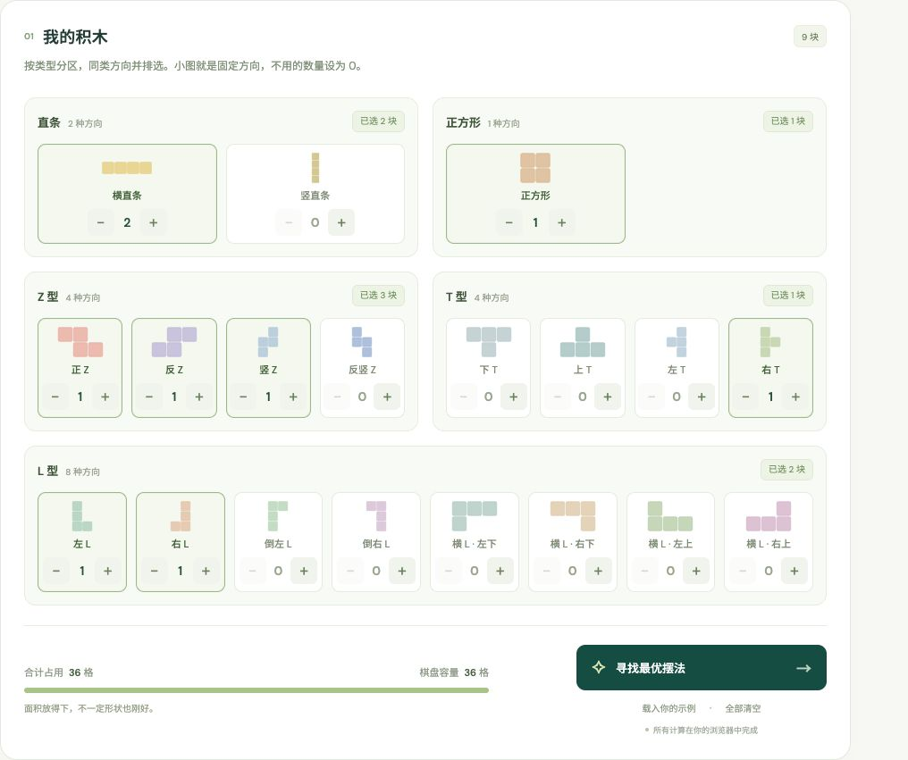

# 积木实验室 · Block Lab

在 **6×6 棋盘**上寻找四格积木的最大摆放方案；如果全部放不下，展示最少移除的组合与各自摆法。

**在线使用：** https://dopafan.github.io/block-lab/



## 功能

- 直条、Z 型、L 型、T 型、正方形五个分区，共 19 种固定方向，全部直接显示。
- 同类型的不同方向并排展示，直接点 + / − 或输入数量；数量 0 表示不用。
- 每块始终占 4 格，只允许平移，禁止旋转、翻转、拆分、重叠和越界。
- 自动寻找最多可放的块数；最少移除组合各提供一个可视化布局。
- 同一块的四格标相同字母，可以导出当前摆放图为 SVG。
- 所有求解在浏览器 Web Worker 中运行，无需账号和后端服务；数量保存在使用者自己的浏览器中。

## 本地运行

需要 Node.js 20 或以上版本，无需安装依赖。

```sh
git clone https://github.com/dopafan/block-lab.git
cd block-lab
npm start
```

打开 http://127.0.0.1:4173/。浏览器模块与 Worker 需要 HTTP，请通过本地服务访问。

## 测试

```sh
npm test
```

11 项测试包含独立穷举对照、全部固定方向、边界与重叠、默认示例、最少移除组合、超时和枚举截断。

## 自动发布

仓库使用 GitHub Pages。每次推送到 main，GitHub Actions 自动执行测试、检查 JavaScript 语法，然后将 dist/ 发布为网页。

首次配置：仓库 Settings → Pages → Build and deployment → Source 选择 GitHub Actions。也可在 Actions 中手动运行 Deploy GitHub Pages。

## 求解说明

程序枚举各形状的全部合法平移位置，结合面积、连通区域容量和失败状态记忆进行完整搜索。完成证明才显示“已证明最优”。

默认时间预算 15 秒；未完成证明时明确提示，再次求解同一配置会将预算增至 60 秒。最少移除组合最多返回 60 种，未列全时会明确说明。每个移除组合展示一个布局，不枚举所有等价空间摆法。

初始示例含 2 根横直条、正 Z、反 Z、竖 Z、左 L、右 T、右 L、正方形各 1 块，共 9 块。按页面小图的方向最多放 8 块，任意一种类型减 1 块都能放下，共 8 种最少移除组合。
